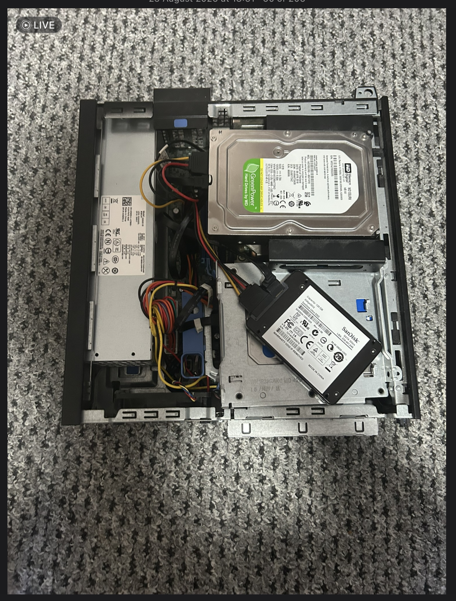
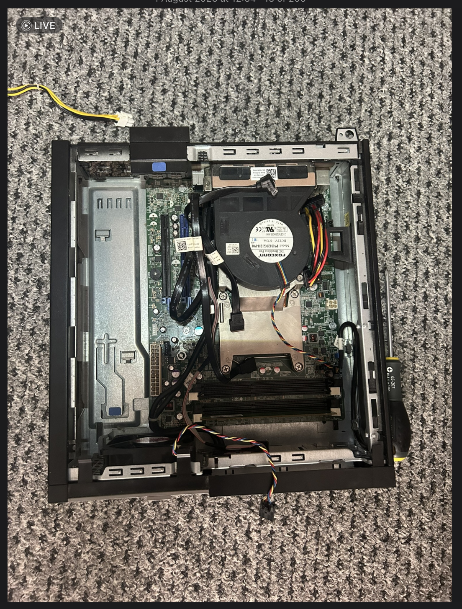
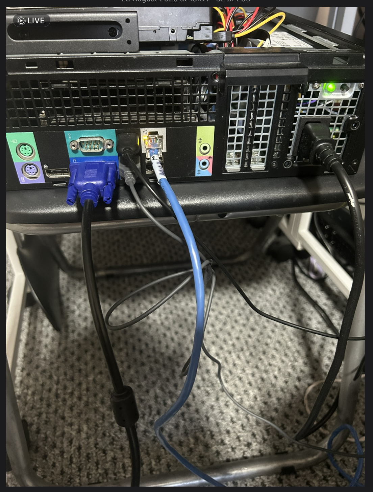

# Lab 01 — Dell OptiPlex PSU Replacement

---

## Objective

Replace a faulty power supply unit (PSU) in a Dell OptiPlex desktop PC and verify that the system powers on successfully after replacement.

**System:** Dell OptiPlex 790

---

## Procedure

### 1. Remove the PC Casing

Disconnect the PC from mains power and remove the casing to access the internal components.

*Figure 1: Internal view of the PC before PSU replacement.*

### 2. Disconnect and Remove the Faulty PSU

Disconnect the PSU power cables from the motherboard and other connected components. Remove the faulty PSU from the chassis.

*Figure 2: Faulty PSU removed from the PC.*

### 3. Install the Replacement PSU

Install the replacement PSU and reconnect the required power cables. Refit any components removed during the procedure and ensure all connections are secure.

### 4. Test the System

Reconnect the PC to mains power and switch it on to verify that the system starts successfully.

*Figure 3: PC after PSU replacement and power-on test.*

---

## Conclusion

The faulty PSU was successfully replaced, and the PC powered on successfully following the replacement. This confirms that the system passed the initial power-on test.